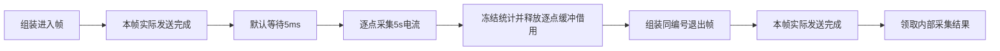

# IDD内部流程与逐点电流采集准备

日期：2026-11-05。用户确认先完成MCU内部流程；电流限值由PC还是MCU判断、0109结果JSON另行确定。本轮不切换正式0108入口，不把采集完成或RK的FUNC结果解释成IDD电流PASS。

## 实现与接入边界

B1/V2新增相同的 `App/protocol/rk/idd_session.c/.h`，加入各自顶层CMake，复用 `tlv_pack_idd_action()`。模块不依赖HAL/FreeRTOS，不访问电源、UART或采样器；调用方串行提供发送完成、时钟和新电流样本事件。离线测试运行实际C代码。

- 进入帧：`5000/u16LE`为21..36，另带`101A/u8=1`；退出使用同编号和`101A=0`。每帧27字节，Seq由RK任务统一分配。
- `idd_session_next_frame()`仅组帧。只有匹配该帧Seq、最后一字节真正发出的事件才能调用 `idd_session_tx_complete()`；`uart_send()`入队成功不能冒充完成。
- 窗口固定为 `[进入帧完成+5ms, 进入帧完成+5005ms)`，轮询滞后不延长窗口；没有样本也会准备退出。心跳、进度0/100和RK的FUNC最终包均不推进内部会话。
- 暂按无RK应答准备，退出帧发完不证明RK已恢复。RK补应答后另接确认阶段，不伪造ACK。
- 提前取消已进入的会话仍准备退出；进入帧在途时等发送完成后退出。发送失败保守进入TX_FAULT，不自动重发或放行下一项；适配层确认真实掉电后才能解除。模块不拉电源。
- 采集质量和发送错误独立保存，没有电流限值或芯片PASS/FAIL字段。电流为0可以是有效数据。

**生产任务尚未绑定**：正式0108/0109仍走原编号/最终结果通道。JSON确定后再绑定UART实际完成/有界发送超时事件和监测任务的新读取事件，独占同一RK事务；所有调用须串行，并按事件时间顺序消费。不能先到期冻结，再补交队列中未消费的窗口内样本；冻结计算不能放在长关中断区。现有UART完成跟踪、跨任务采样交接和运行期缓冲预留本轮均未启用。

## 逐点保存、计算与内存

每点16字节：三轨 `uint32_t current_ua`（VDD1/VDD2/VDDQ）、相对完成时间 `uint16_t offset_ms`、有效位和保留字节。时间为0..4999ms；读取流水号另行递增，同一毫秒的不同新样本不会被误删。适配层须在转换现有u64工程值时检查u32范围，不得截断。

读取起止均落在窗口内的新点全部顺序保存，不降采样、不环形覆盖。失败读取也留记录，无效轨的零占位不参加统计。容量满时明确标记OVERFLOW并提前准备退出，不能把不完整采集说成成功。保留读取流水号缺口、重复/逆序、跨窗口记录、逐轨失败数和最大无新记录间隔。

结束时从保存的点计算三轨64位累加和、有效数、失败数、算术均值、最小/最大值，再解除逐点缓冲借用供复用；小型结果保留到领取。算术均值不是时间加权均值，样点峰值不是全部瞬态峰值。逻辑释放不要求清零整块RAM，也不写Flash。

| 示例速率 | 5s记录数 | 逐点空间 |
|---|---:|---:|
| 100组/s | 500 | 8000字节，约7.8KiB |
| 500组/s | 2500 | 40000字节，约39.1KiB |
| 1024组/s | 5120 | 81920字节，80KiB |

默认容量5120组；每次采集只写一条固定记录，结束最多处理15360个电流值并做3次均值除法。数据量可控，但没有测量实板CPU占用率。

缓冲由调用方静态提供，不新增全局80KiB占用，不放任务栈、不从128KiB FreeRTOS堆申请。实际启用应在AXI SRAM预留：本次B1构建DTCM已用50072字节，再加81920字节将超128KiB；AXI区已用136352/524288字节，另加80KiB后仍有306016字节链接空间。本轮没有修改链接布局，也不能把该空间当作RTOS当前空闲堆。

## 不丢数据的适用范围

现有FUNC统计已纳入每次被读取且符合窗口的新样本，只是没有逐点数组。本模块完整保存的是MCU实际提交的新读取，不改变PAC配置、AD扫描或电源流程。

PAC配置1024 SPS，现有循环还包含REFRESH_V等待、I²C、AD/TPS和调度。实际读取率不能等同1024组/s；VSENSE只提供最近转换结果，8点平均寄存器也不是历史FIFO或5s电流累加器。两次读取之间未取出的转换，不能靠MCU数组恢复。依据：[PAC193x DS20005850E](https://ww1.microchip.com/downloads/en/DeviceDoc/PAC1931-Family-Data-Sheet-DS20005850E.pdf)§4.1.2、4.1.4及VSENSE/VSENSE_AVG寄存器说明。

流水号缺口仅反映调用方采样事件缺口，不检测PAC内部漏读转换。持续读取率、总线/初始化空档、噪声、精度及并发负载仍须实板验收；记录更多样点不等于捕获所有短脉冲。

## JEDEC核对与判限位置

核对[JESD209-4B（2017）第9章公开副本](https://studylib.net/doc/27908019/jesd209-4b)第274～283页，并对照[Micron LPDDR4/LPDDR4X Rev.E（2020）](https://e2e.ti.com/cfs-file/__key/communityserver-discussions-components-files/908/MT53E1G16D1FW_2D00_046-AIT--A-MCR-Datenblatt_2800_P010694655_2900_.pdf)的IDD章节和表189。JEDEC官网本次未能直接读取，公开副本不构成最新版核验。

上述章节未给出统一“进入后5ms、采集5s”的要求；重点是初始化、CKE/时钟/总线模式、ODT、操作/刷新节拍及电压温度条件。例如IDD5AB用tREFI、IDD5PB用tREFI/8，这是RK保持操作节拍，不是MCU总采样时间。5ms/5s只作为用户指定的开发默认值，不宣称JEDEC完整合规，也不套用其他DDR世代的建立时间。

判限位置仍待确定。建议由PC维护随料号、IDD项目、频率、电压和温度变化的限值，MCU负责采集质量/统计；若之后要求脱离PC自主判定，再明确限值下发合同。这是建议，没有固定进固件。

两颗DDR共用三轨测量，没有单颗电流；后续须明确整板/单颗、每轨/合计、平均/峰值、缺失数据及限值比较边界。不能直接把单颗datasheet限值复制到两颗mirrorIndex，也不能凭共轨超限定位哪颗FAIL。

## 验证与交付边界

`tests/verify_idd_session_c.py`在Cortex-M7 QEMU运行各板实际会话、帧及CRC：覆盖16项进入/退出、5ms/5s和回绕、5120条逐点逐值保留、同毫秒多点、u32满量程累加、无效轨、缺口/重复/逆序、空窗口、溢出、取消、掉电、进入/退出发送失败和结果一次领取。

两板新会话及既有RK实际C回归、纯接口头/分层检查、独立目录Debug构建和镜像文件检查通过。产物在各自 `build/idd-prepare-20261105-build/`，证据在V2的 `build/idd_prepare_20261105/validation.json`。

未修改服务器、电源/采样驱动、正式PC入口或JSON，未烧录、提交或推送。离线通过不代表实际RK状态、传感器速率或测量精度通过。
